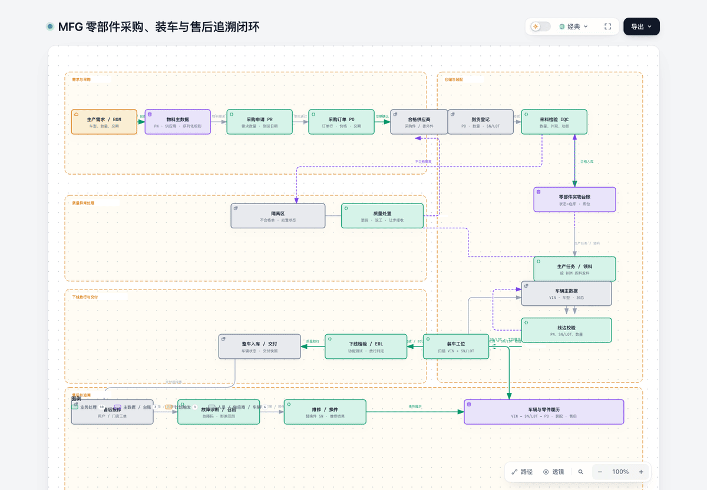

# skills-lab

A small public collection of Agent Skills that can be added, tested, and shared over time. Each skill lives under `skills/<name>/`; Chinese is the default language and English documentation is provided here.

The first skill is [`flow-builder`](skills/flow-builder/SKILL.md). It helps an agent turn a business process, screenshot, HTML reference, spreadsheet, or rough request into an interactive system prototype. It covers more than diagrams: forms, CRUD, ledgers, state transitions, role views, exception handling, traceability, and a path toward production code.

The second skill is [`portal-dashboard`](skills/portal-dashboard/SKILL.md): a "Clash-panel-inspired" docs-first portal visual system (warm gray background, near-white cards, iOS blue, large-radius pills, tabular numerals) for local knowledge-base / script portal home pages. It ships with a self-contained [`assets/starter.html`](skills/portal-dashboard/assets/starter.html) starter template (zero dependencies, opens directly from `file://`) and [`references/measurements.md`](skills/portal-dashboard/references/measurements.md) sampling records.



## Example

[`examples/mfg-procurement-to-assembly.html`](examples/mfg-procurement-to-assembly.html) is a sanitized manufacturing example. It shows a component moving through purchasing, receipt, inspection, inventory, picking, installation binding, release, delivery, service lookup, and replacement trace. It uses synthetic data only and contains no private Feishu URL, token, or local path.

[`examples/mfg-vcu-after-sales-replacement.html`](examples/mfg-vcu-after-sales-replacement.html) is a smaller vertical slice for an after-sales VCU replacement. It covers the Feishu task, VIN and old-part lookup, new-part validation, UDS/BLE write, readback, the Melon replacement transaction, task callback, and reverse trace. The [Chinese implementation plan](examples/mfg-vcu-after-sales-implementation-plan.md) and [English plan](examples/mfg-vcu-after-sales-implementation-plan.en.md) describe ownership, API order, data authority, migration, and acceptance cases.

Preview locally:

```bash
python3 -m http.server 8792 --directory examples
# Open http://127.0.0.1:8792/mfg-procurement-to-assembly.html
```

## Installation

### Cross-agent install (recommended)

Use [`npx skills`](https://skills.sh). It symlinks by default: one canonical copy lives in `~/.agents/skills/<name>`, and Claude Code gets `~/.claude/skills/<name>` pointing to it.

```bash
# all skills -> Claude Code + Codex
npx skills add TNT-Likely/skills-lab -g -a claude-code -a codex --skill '*' -y

# one skill
npx skills add TNT-Likely/skills-lab --skill flow-builder -g -a claude-code -a codex -y

# after the repo updates (global install)
npx skills update -g
```

`--copy` switches to independent copies; update them with `npx skills update` too, not by reinstalling.

### Claude Code plugin marketplace

```text
/plugin marketplace add TNT-Likely/skills-lab
/plugin install flow-builder@skills-lab
/plugin install portal-dashboard@skills-lab
```

Claude Code manages updates through `/plugin`; Claude Code users do not need `npx skills`.

### Local development (link the repo)

```bash
git clone https://github.com/tnt-likely/skills-lab.git
cd skills-lab
./scripts/install.sh               # all skills -> ~/.agents/skills + ~/.claude/skills
./scripts/install.sh flow-builder  # one skill
./scripts/install.sh --copy        # independent copies
```

The working tree is the source: edits or `git pull` are picked up by the next agent session, with no update step. This is for local authoring; use `npx skills` or the plugin marketplace for distribution.

- Symlink rather than hard link: a git pull or checkout replaces file inodes, which breaks hard links, and hard links cannot cover new `assets/` or `references/` files.
- The installer refuses to overwrite an existing entry; check it and use `--force` if intended.
- Multi-skill repos should not keep a root `SKILL.md`: when one exists, `npx skills` treats it as the only skill and ignores `skills/`. Every skill lives at `skills/<name>/SKILL.md`.

## Repository layout

```text
skills-lab/
├── README.md
├── README.en.md
├── .claude-plugin/
│   └── marketplace.json
├── skills/
│   ├── flow-builder/
│   │   └── SKILL.md
│   └── portal-dashboard/
│       ├── SKILL.md
│       ├── assets/
│       │   └── starter.html
│       └── references/
│           └── measurements.md
├── examples/
│   ├── demo.gif
│   └── mfg-procurement-to-assembly.html
└── scripts/
    ├── install.sh
    └── validate.py
```

## Publishing rules

Examples must use synthetic data. Before publishing, scan HTML, docs, images, and scripts for private URLs, tokens, personal paths, and unauthorized business material.

## License

MIT
