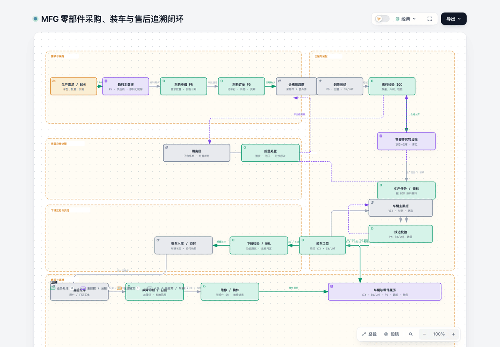

# skills-lab

一个可以持续收集、验证和分享 Agent Skills 的小仓库。每个 Skill 都放在 `skills/<name>/` 下，默认中文，英文说明放在对应的 `README.en.md` 或仓库级英文文档中。

当前第一个 Skill 是 [`flow-builder`](skills/flow-builder/SKILL.md)：它帮助 Agent 把业务流程、截图、HTML、表格或口述需求，整理成可以真正操作的系统原型。它不只生成流程图，也关注表单、CRUD、台账、状态流转、角色视图、异常处理、追溯和未来代码迁移。

第二个 Skill 是 [`portal-dashboard`](skills/portal-dashboard/SKILL.md)：一套「Clash 面板风」的文档优先门户视觉系统（暖灰底、近白卡片、iOS 蓝、大圆角胶囊、tabular 数字），用于本地知识库 / 脚本门户首页。附带 [`assets/starter.html`](skills/portal-dashboard/assets/starter.html) 自包含起步模板（零依赖、file:// 直开）与 [`references/measurements.md`](skills/portal-dashboard/references/measurements.md) 采样记录。



## 示例

[`examples/mfg-procurement-to-assembly.html`](examples/mfg-procurement-to-assembly.html) 是一个脱敏的制造流程示例，展示零部件从采购、到货、质检、入库、领料、装配绑定、下线放行、交付到售后反查的交互式图表。它只使用合成业务数据，不包含飞书地址、访问令牌或内部路径。

[`examples/mfg-vcu-after-sales-replacement.html`](examples/mfg-vcu-after-sales-replacement.html) 是一个更小的纵向切片，专门演示售后 VCU 换件：飞书任务、VIN/旧件查询、新件校验、UDS/蓝牙写入、读回、Melon 换件事务、任务回写和反向追溯。配套的 [中文实施计划](examples/mfg-vcu-after-sales-implementation-plan.md) 和 [English plan](examples/mfg-vcu-after-sales-implementation-plan.en.md) 说明了职责边界、接口顺序、数据主权、迁移路径和验收矩阵。

本地预览：

```bash
python3 -m http.server 8792 --directory examples
# 浏览器打开 http://127.0.0.1:8792/mfg-procurement-to-assembly.html
```

## 安装

### Codex

```bash
mkdir -p ~/.codex/skills/flow-builder
curl -L https://raw.githubusercontent.com/tnt-likely/skills-lab/main/skills/flow-builder/SKILL.md \
  -o ~/.codex/skills/flow-builder/SKILL.md
```

### Claude Code / Gemini CLI / 通用 Agent

把 `skills/flow-builder/` 复制到该 Agent 的 skills 目录，或直接把其中的 `SKILL.md` 加入 Agent 的技能搜索路径：

```bash
git clone https://github.com/tnt-likely/skills-lab.git
cp -R skills-lab/skills/flow-builder ~/.agents/skills/flow-builder
```

不同运行时的技能目录可能不同；关键要求是保留目录名 `flow-builder` 和其中的 `SKILL.md`。根目录的 `SKILL.md` 也可直接作为单文件技能加载。

## 目录

```text
skills-lab/
├── README.md
├── README.en.md
├── SKILL.md
├── skills/
│   ├── flow-builder/
│   │   └── SKILL.md
│   └── portal-dashboard/
│       ├── SKILL.md
│       ├── assets/
│       │   └── starter.html
│       └── references/
│           └── measurements.md
├── examples/
│   ├── demo.gif
│   └── mfg-procurement-to-assembly.html
└── scripts/
```

## 发布约定

示例必须使用合成数据。提交前检查 HTML、文档、图片和脚本中是否包含私有 URL、令牌、个人路径或未授权业务资料。

## License

MIT
